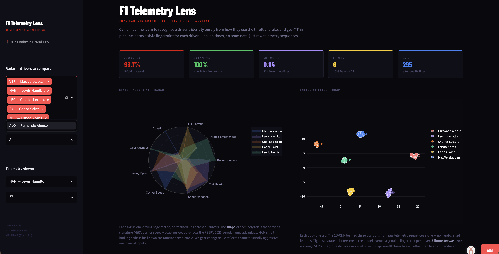
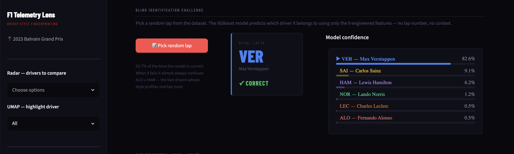
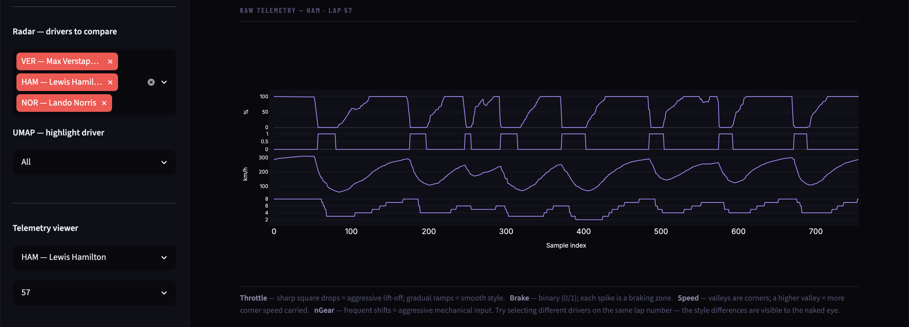
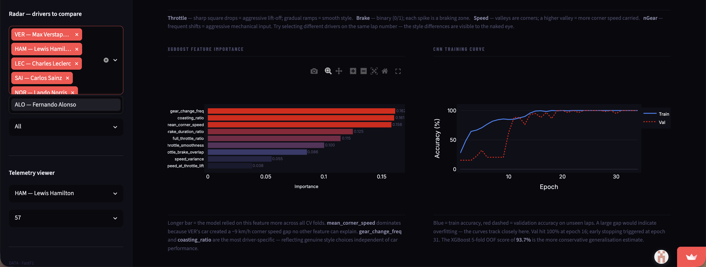
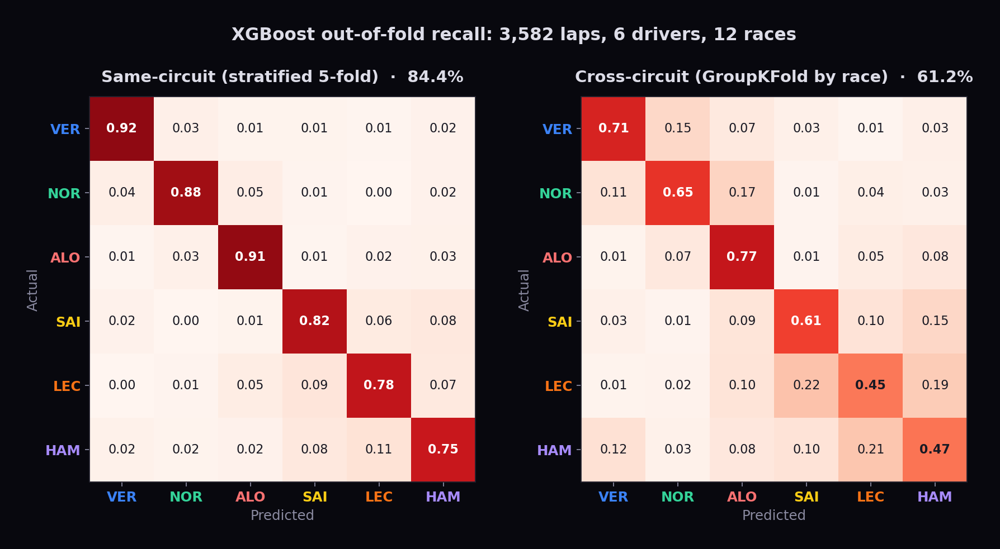
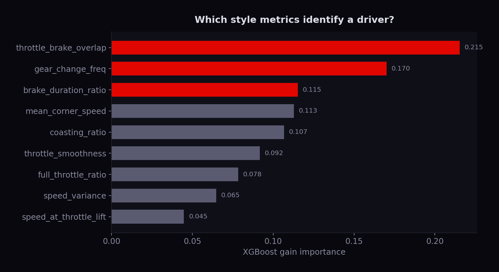
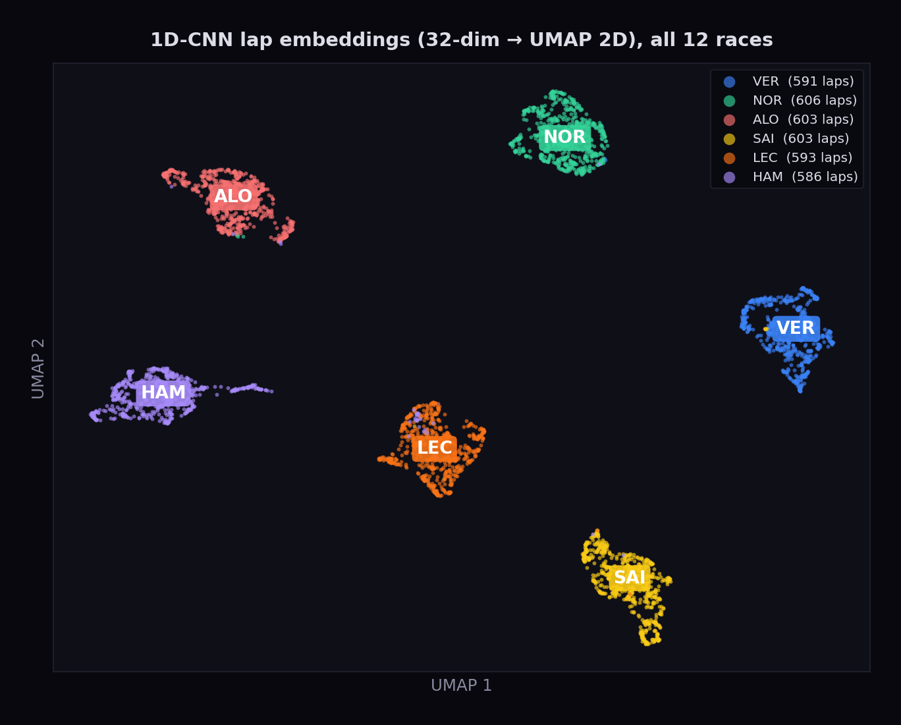
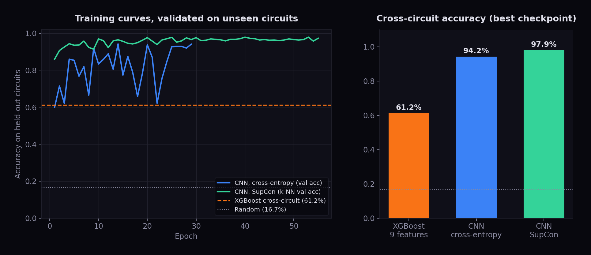
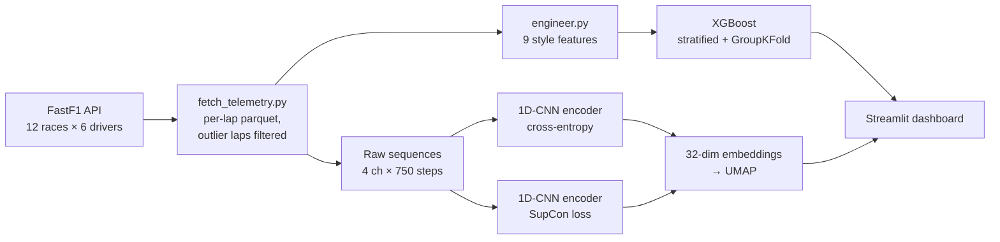

<div align="center">

# 🏎️ F1 Telemetry Lens

**Identifying Formula 1 drivers from raw telemetry alone: no lap times, no team labels, no circuit hints.**

[](https://f1-telemetry-lens.streamlit.app/)


<br>



</div>

---

## TL;DR

Every driver has a signature in how they brake, use the throttle, and shift gears. This project tests whether a model can learn that signature from raw FastF1 telemetry and still recognise the driver **on circuits it has never seen**.

- **Data:** 3,582 race laps · 6 drivers (VER, HAM, ALO, LEC, SAI, NOR) · 12 Grands Prix across the 2023 and 2024 seasons
- **Models:** an interpretable **XGBoost** baseline on 9 engineered features, a **1D-CNN** encoder trained on raw sequences, and a **Supervised Contrastive (SupCon)** variant
- **Evaluation:** whole circuits held out with `GroupKFold`/`GroupShuffleSplit`, so no lap from a test track appears in training
- **Product:** an interactive [Streamlit dashboard](https://f1-telemetry-lens.streamlit.app/) with a blind-identification challenge and a lap *sonifier* that turns telemetry into audio

| Model | Input | Same-circuit acc. | **Cross-circuit acc.** |
|---|---|:---:|:---:|
| Random baseline | – | 16.7% | 16.7% |
| XGBoost | 9 hand-crafted per-lap features | 84.4% | **61.2%** |
| 1D-CNN (cross-entropy) | Raw throttle / brake / speed / gear | – | **94.2%** |
| 1D-CNN (SupCon, k-NN probe) | Raw throttle / brake / speed / gear | – | **97.9%** |

> **Note on the results.** An early CNN version reached 99.4% because it was using RPM, which mostly reflects the **power unit** rather than the driver. I found the leak, removed the channel, and wrote it up. The [Limitations](#limitations--honest-caveats) section covers the car-vs-driver confound that is still open.

---

## Dashboard

The app has four tabs with no sidebar, and each control sits next to the chart it changes. Headline metrics are **computed at load time from the pipeline outputs** rather than hardcoded, so they update whenever the models are retrained.

<table>
<tr>
<td width="50%" valign="top">
<b>Blind test</b>: draw a random lap and see whether the model identifies the driver. Each prediction is a true <b>out-of-fold</b> prediction, so the model never trained on that lap. An audit panel shows the exact feature vector and telemetry trace.
<br><br>

</td>
<td width="50%" valign="top">
<b>Telemetry &amp; audio</b>: overlay any two drivers' throttle, brake, speed and gear traces. The sonifier maps RPM to pitch, throttle to volume and braking zones to percussion, so you can <i>hear</i> a smooth trail-braker next to a late braker.
<br><br>

</td>
</tr>
<tr>
<td colspan="2" valign="top">
<b>Model</b>: feature importances, CNN training curves on held-out circuits, the gap between the two cross-validation schemes, and the known limitations.
<br><br>

</td>
</tr>
</table>

---

## Results

All figures below are generated from the current 12-race artefacts by [`src/viz/make_figures.py`](src/viz/make_figures.py).

### 1. Hand-crafted features work, and the evaluation shows how much is track-specific



The same XGBoost model is evaluated two ways. With **stratified 5-fold** (laps from one race can appear in both train and validation) it reaches 84.4%. With **GroupKFold by race** (entire circuits held out) it reaches 61.2%. The **23-point gap** shows that a real share of the hand-crafted signal is track-specific. VER, ALO and NOR stay distinctive on unseen tracks. LEC and HAM, both smooth drivers who lean heavily on trail braking, are the most often confused.

<table>
<tr>
<td width="55%"></td>
<td width="45%" valign="top">

**Most informative features**

| Feature | Driving-style signal |
|---|---|
| `throttle_brake_overlap` | Trail braking |
| `gear_change_freq` | Mechanical aggression |
| `brake_duration_ratio` | Braking share of the lap |
| `mean_corner_speed` | Minimum-speed commitment |
| `coasting_ratio` | Lifting before braking |

</td>
</tr>
</table>

### 2. A CNN learns a stronger fingerprint from raw sequences



The CNN never sees engineered features. It receives four raw channels resampled to 750 timesteps and learns a **32-dimensional embedding per lap**. Projected with UMAP, laps from 12 races form six clearly separated driver clusters (silhouette **0.51** for cross-entropy, **0.90** cosine for SupCon). For every driver, laps by the same driver are 2.3×–3.3× closer to each other than to other drivers' laps.

### 3. A contrastive objective beats training through a classifier



Replacing cross-entropy with a **SupCon loss**, which pulls same-driver laps together and pushes other drivers' laps apart, makes training more stable and the embedding space tighter. This matches what the representation-learning literature reports for small datasets.

---

## How it works



**CNN encoder** (~40K parameters, intentionally small for about 3.6K laps):

```
(batch, 4, 750)
 → Conv1d(4→32,  k=7) · BN · ReLU · MaxPool
 → Conv1d(32→64, k=5) · BN · ReLU · MaxPool
 → Conv1d(64→128,k=3) · BN · ReLU · AdaptiveAvgPool
 → Linear(128→32)        ← lap embedding
 → Linear(32→6)          ← classifier head (cross-entropy variant only)
```

<details>
<summary><b>The 9 engineered features</b></summary>

| Feature | Definition | Style signal |
|---|---|---|
| `brake_duration_ratio` | Fraction of lap with brake pressed | Heavy vs. light braker |
| `throttle_smoothness` | Mean absolute diff between consecutive throttle samples | Smooth vs. aggressive pedal |
| `full_throttle_ratio` | Fraction of lap at ≥ 98% throttle | Time flat-out |
| `coasting_ratio` | Brake = 0 and throttle < 10% | Lifting early before corners |
| `gear_change_freq` | Gear shifts per 100 samples | Mechanical aggression |
| `speed_at_throttle_lift` | Mean speed at sharp throttle drops | Late braking |
| `mean_corner_speed` | Mean speed when gear ≤ 4 | Corner-speed commitment |
| `speed_variance` | Std. dev. of speed across the lap | Speed differentials |
| `throttle_brake_overlap` | Throttle > 10% and brake on | Trail braking |

</details>

---

## Limitations & honest caveats

- **Car vs. driver confound (the main open question).** RPM range is set by the power unit, and including it pushed CNN accuracy to a suspicious 99.4%. After removing it, the CNNs still beat XGBoost by more than 30 points. This may be fine-grained driving style that summary features lose, or it may be car/aero signal that still leaks through `Speed` and `nGear` (top speed and gearing differ by team). The clean test is the **teammate experiment** below.
- **Small number of classes.** Six drivers on four teams, with LEC/SAI as the only teammate pair, make the identification task easier than real-world use.
- **Checkpoint selection.** CNN checkpoints are selected on the held-out-circuit validation split, so the CNN numbers are slightly optimistic. A separate test split of circuits would remove this bias.

## Roadmap

- [ ] **Teammate study:** VER vs. PÉR, LEC vs. SAI, HAM vs. RUS in identical machinery, to separate driver style from the car
- [ ] **Leave-one-circuit-out test split** for the CNNs, separate from checkpoint selection
- [ ] **Cross-team stability:** does the fingerprint follow a driver who changes teams (e.g. HAM 2025, SAI 2025)?
- [ ] **Corner-level fingerprints:** which corners reveal the most about a driver
- [ ] **Anomaly detection:** flag laps that are out of distribution for a driver (damage, tyre drop-off, safety car)

---

## Quickstart

```bash
git clone https://github.com/NifraWahaj/f1-telemetry-lens.git
cd f1-telemetry-lens
python -m venv venv && source venv/bin/activate
pip install -r requirements.txt

streamlit run app/streamlit_app.py      # dashboard runs on the committed artefacts
```

<details>
<summary><b>Reproduce the full pipeline</b></summary>

Drivers and races are set in [`config.yaml`](config.yaml). Any FastF1-supported driver and season from 2018 onward works, and every stage loops over the full race list.

```bash
python src/data/fetch_telemetry.py        # download + cache telemetry (~200 MB, first run only)
python src/features/engineer.py           # per-lap style features
python src/models/baseline.py             # XGBoost: stratified + GroupKFold OOF predictions
python src/models/cnn_encoder.py          # 1D-CNN (cross-entropy) + embeddings + UMAP
python src/models/contrastive_encoder.py  # 1D-CNN (SupCon) variant
python src/viz/make_figures.py            # regenerate README figures
```

Exploratory analysis lives in [`notebooks/`](notebooks/) (data exploration → features → baseline + SHAP → embeddings).

</details>

## Project structure

```
f1-telemetry-lens/
├── app/streamlit_app.py          # 4-tab dashboard, blind test, sonifier
├── src/
│   ├── data/fetch_telemetry.py   # FastF1 ingestion, lap filtering, parquet cache
│   ├── features/engineer.py      # 9 driving-style features
│   ├── models/
│   │   ├── baseline.py           # XGBoost + dual CV scheme
│   │   ├── cnn_encoder.py        # 1D-CNN, cross-entropy
│   │   └── contrastive_encoder.py# 1D-CNN, SupCon loss
│   └── viz/make_figures.py       # README figures from saved artefacts
├── notebooks/                    # EDA and analysis
├── data/features/                # features, OOF predictions, embeddings, UMAP coords
├── outputs/{models,figures}/     # trained models and figures
└── config.yaml                   # races, drivers, channels, seed
```

## Tech stack

**ML:** PyTorch · XGBoost · scikit-learn · SHAP · UMAP  **Data:** FastF1 · pandas · NumPy · PyArrow  **App:** Streamlit · Plotly · NumPy audio synthesis

---

<div align="center">
<sub>Telemetry from official F1 timing feeds via <a href="https://github.com/theOehrly/Fast-F1">FastF1</a>. This is an unofficial project and is not affiliated with Formula 1.</sub>
<br>
<sub>Built by <a href="https://github.com/NifraWahaj">Nifra Wahaj</a></sub>
</div>
